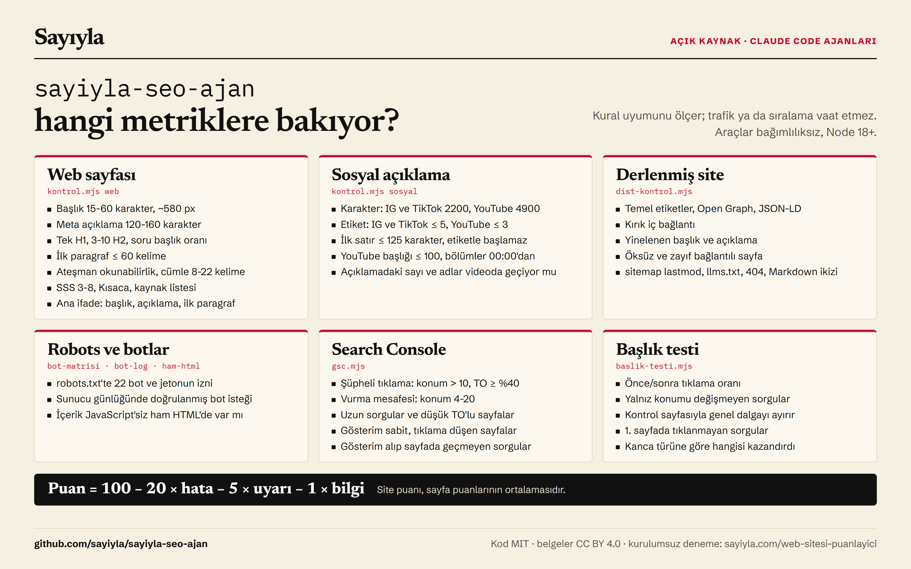

# sayiyla-seo-ajan

**Web siteleri için SEO / AEO / GEO metin düzeltici ve Instagram, TikTok, YouTube için SEO açıklaması yazıcı: Claude Code ajanları + bağımsız denetleyici araçlar.**

*English summary: Claude Code subagents that fix page copy for SEO, AEO (answer engines) and GEO (AI search citations) and write SEO-friendly captions for Instagram, TikTok and YouTube (Turkish-first). Ships with dependency-free Node tools: a text linter with Turkish readability, a CI gate for built sites with baseline support, a robots.txt AI-bot matrix, a bot-log analyzer, a raw-HTML checker, Search Console CSV analysis and an agent-file security scanner, plus a planted-defect benchmark. Every rule carries an evidence label; the agents never invent facts.*

Sayıyla'da ([sayiyla.com](https://sayiyla.com)) kullandığımız kuralların bağımsız, herkesin kullanabileceği hâli. Sıfır bağımlılık, Node 18+. Ticari kullanım dahil serbest (MIT ve CC BY 4.0).

**Hızlı kurulum (Claude Code eklentisi):**

```text
/plugin install sayiyla-seo-ajan --marketplace sayiyla/sayiyla-seo-ajan
```

**Codex ve diğer ajanlar:** repoyu klonla; ajan kökteki [AGENTS.md](AGENTS.md) dosyasını okur ve aynı üç görevi aynı araçlarla yapar.

**Kurulumsuz deneme:** [Web Sitesi Puanlayıcı](https://sayiyla.com/web-sitesi-puanlayici/) (sayiyla.com) bir sayfanın adresini alır, tarayıcıda SEO, AEO ve GEO açısından 100 üzerinden puanlar; eksikleri, düzeltme kodlarını ve her ölçütün dayanağını gösterir. Ücretsizdir, hesap istemez. Bu repodaki araçlar ise aynı işi yerelde ve CI'da yapar: yayından önce metin (`kontrol.mjs`), derlenmiş site (`dist-kontrol.mjs`) ve Search Console verisi (`gsc.mjs`, `baslik-testi.mjs`).

Eski sürümlerde iki adım: `/plugin marketplace add sayiyla/sayiyla-seo-ajan`, sonra `/plugin install sayiyla-seo-ajan@sayiyla`. Ajanlar `sayiyla-seo-ajan:web-seo-duzeltici` gibi adlarla gelir.

## Ne var?

**Ajanlar** (`.claude/agents/`):

| Ajan | Ne yapar |
|---|---|
| `web-seo-duzeltici` | Sayfanın başlığını, meta açıklamasını, ilk paragraf cevabını, ara başlıklarını, Kısaca ve SSS bölümlerini, cümle ritmini **olguları değiştirmeden** düzeltir. Kontrol → düzelt → yeniden kontrol, en çok 3 tur. |
| `sosyal-seo-aciklama` | Instagram, TikTok ve YouTube için açıklama (ve YouTube başlığı) yazar ya da düzeltir. Videoda olmayan vaat yazmaz, etkileşim yemi yazmaz, hiçbir platforma gönderi yapmaz. |
| `seo-aeo-geo-denetci` | Canlı sayfayı ve site düzeyini salt okur denetler, öncelikli rapor verir. |

**Araçlar** (`araclar/`, hepsi bağımlılıksız):

| Araç | Ne yapar |
|---|---|
| `kontrol.mjs` | Tek metin: web sayfası (Markdown/HTML) ya da sosyal açıklama. Kural denetimi, 0-100 puan, metrikler, `--anahtar` (ana arama ifadesi), `--transkript` (açıklama videoyla tutarlı mı), `--baseline`. |
| `dist-kontrol.mjs` | Derlenmiş site yayın kapısı: temel etiketler, OG, JSON-LD, kırık iç bağlantı, yinelenen başlık/açıklama, öksüz sayfa, sitemap, llms.txt, Markdown ikizi. `--esik`, `--baseline`. |
| `bot-matrisi.mjs` | `robots.txt` için 22 arama/yapay zekâ botu ve jetonunun erişim tablosu, tutarsızlık uyarıları. |
| `bot-log.mjs` | Sunucu günlüğünden bot ziyaretleri; IP listesiyle doğrulama (User-Agent tek başına kanıt değildir). |
| `ham-html.mjs` | JavaScript'siz ham HTML'i farklı bot adlarıyla çekip karşılaştırır (içerik ham HTML'de mi, bot engeli var mı). |
| `gsc.mjs` | Search Console CSV analizi: şüpheli tıklama sıçraması, "vurma mesafesi", uzun sorgular, içerik çürümesi, düşük tıklama oranı (başlık testi adayları) ve bir sayfanın **boşluk analizi** (gösterim alıp sayfada geçmeyen sorgular, konum 10-30). |
| `baslik-testi.mjs` | **Başlık testi defteri:** değiştirilen başlığın tıklama oranını önce/sonra ölçer (yalnız konumu değişmeyen sorgular, kontrol sayfasıyla genel dalga ayrılır), birinci sayfada gösterilip hiç tıklanmayan sorguları listeler, biten testlerden hangi kanca türünün işe yaradığını özetler. |
| `gorunurluk.mjs` | Yapay zekâ görünürlük ölçümü: aynı soruları web aramalı modellere (OpenAI, Gemini, OpenRouter; anahtar isteğe bağlı) birkaç kez sorar, marka anılmasını, sitenin kaynak gösterilmesini ve rakip alan adlarını motor motor sayar. Çevrimdışı analiz modu var. API çağrıları belgelere göre yazıldı, canlı denenmedi. |
| `ajan-tara.mjs` | Ajan ve skill dosyalarını güvenlik açısından tarar (uzak betik, talimat ezme, gizli karakter, kimlik bilgisi). |
| `tazelik.mjs` | Kurallar dosyalarının "son gözden geçirme" yaşını denetler. |
| `benchmark/calistir.mjs` | Kusurlu ve temiz 22 vakayla araçları ölçer; yanlış alarm da hata sayılır. |

**Kurallar** (`kurallar/`): web SEO/AEO/GEO, sosyal açıklama (platform sayıları "kesin / doğrulanamadı" ayrımıyla), başlık kancaları, teknik SEO (Yandex dahil), makine okunur sunum (Markdown ikizi, llms.txt, JSON-LD grafı, IndexNow), ölçüm protokolü, sayfa kalitesi listesi, **kanıt defteri** (neye inanıyoruz, neyi kural yapmadık) ve **kural kataloğu** (her kuralın kanıt sınıfı ve bilinen yanlış-pozitif sınırı).

**Araştırma** (`docs/ARASTIRMA.md`): benzer açık kaynak depolar, X ve resmî belgelerden alınan/alınmayan fikirler, lisans notları.

## Hangi metriklere bakıyor?



Araçlar **kural uyumuna** bakar; trafik ya da sıralama ölçmez ve vaat etmez.

- **Web sayfası:** başlık 15-60 karakter ve tahmini ~580 px (hedef 50-60 karakter), meta açıklama 120-160, tek H1, 3-10 H2, soru biçimli başlık oranı, ilk paragraf ≤ 60 kelime, ortalama cümle 8-22 kelime (hedef 10-18), 30+ kelimelik cümleler, **Ateşman okunabilirlik** (Türkçe; 50 altı uyarı), Türkçe ton izi (`-mektedir` yoğunluğu, art arda aynı cümle başı, klişe), SSS 3-8, Kısaca, kaynak listesi, kaynaksız sayı yoğunluğu, abartı sözcükleri, ana ifade (başlıkta, açıklamada, ilk paragrafta, yığma yok), HTML'de JSON-LD, kanonik, alt metin.
- **Sosyal açıklama:** karakter sınırı (Instagram/TikTok 2200, YouTube 4900), etiket sayısı (IG/TikTok ≤ 5 hata, YouTube ≤ 3 uyarı; YouTube 60+ hata), ilk satır ≤ 125 karakter ve etiketle başlamaz, YouTube başlığı ≤ 100, YouTube bölümleri (00:00, ≥ 3 damga, artan, ≥ 10 sn), ana ifade, açıklamadaki sayı ve özel adlar videoda geçiyor mu, gizli karakter, abartı ve ünlem.
- **Derlenmiş site:** her sayfada temel etiketler, OG, JSON-LD geçerliliği, kırık iç bağlantı, yinelenen başlık/açıklama, öksüz ve zayıf bağlantılı sayfalar, sitemap `lastmod`, llms.txt bağlantıları, 404, Markdown ikizi.
- **Robots ve botlar:** 22 bot ve jetonun izinli/engelli durumu; sunucu günlüğünde bot isteği ve doğrulanma oranı; ham HTML'de içerik var mı.
- **Search Console CSV:** konum > 10 ve TO ≥ %40 satırlar (şüpheli), konum 4-20 yüksek gösterimli sorgular, uzun sorgular, düşük tıklama oranlı sayfalar, gösterim sabit ama tıklama düşen sayfalar, gösterim alıp sayfada geçmeyen sorgular.
- **Başlık testi:** konumu değişmeyen sorgularda önce/sonra tıklama oranı, kontrol sayfasına göre düzeltilmiş fark, birinci sayfada gösterilip tıklanmayan sorgular, kanca türüne göre biten testlerin özeti.
- **Puan:** 100 − 20/hata − 5/uyarı − 1/bilgi. Site puanı sayfa puanlarının ortalamasıdır.

## Nasıl çalışır?

Hesabı kod yapar, yazmayı model yapar:

1. **Araç ölçer.** `kontrol.mjs` kuralları sayar ve puan verir; JSON çıktıda her bulgunun `oneri` alanı düzeltme stratejisini söyler.
2. **Ajan düzeltir.** Ajan bulgulara göre metni düzeltir; olgu uydurmaz, bilmediğine `[DOĞRULANMADI]` yazar.
3. **Araç yeniden ölçer.** Hata kalmayana ya da 3 tura kadar. Ajan `git diff` ile anlam değişmiş mi diye bakar.

Model sayıları kendisi üretmez; puan her zaman aracın çıktısıdır, böylece sonuç tekrarlanabilir.

## Kurulum

**1. Eklenti olarak (önerilen):** yukarıdaki `/plugin install` satırı. Araçlar ve kurallar eklentiyle birlikte gelir; ajanlar onları kendi klasöründen çalıştırır.

**2. Repo olarak:**

```bash
git clone https://github.com/sayiyla/sayiyla-seo-ajan.git
cd sayiyla-seo-ajan
npm test          # benchmark + kural tazeliği + ajan güvenlik taraması
```

Bu repoyu Claude Code ile açtığında ajanlar (`.claude/agents/`) zaten hazırdır. Araçlar Node 18+ ile tek başına da çalışır; `npm install` gerekmez.

## Kullanım

```text
Claude Code içinde:
  "yazilar/ornek.md sayfasının SEO'sunu düzelt (ana ifade: kahve makinesi nasıl seçilir)"   → web-seo-duzeltici
  "bu videonun YouTube başlığını ve açıklamasını yaz" (transkript ver)                      → sosyal-seo-aciklama
  "https://ornek.com sitesini SEO/AEO/GEO açısından denetle"                                → seo-aeo-geo-denetci
```

Araçlar tek başına da çalışır:

```bash
node araclar/kontrol.mjs web yazilar/ornek.md --anahtar "kahve makinesi nasıl seçilir" --esik 80
node araclar/kontrol.mjs sosyal instagram aciklama.txt --transkript video-metni.txt
node araclar/kontrol.mjs sosyal youtube aciklama.txt --baslik "Video başlığı"
node araclar/dist-kontrol.mjs dist --site https://ornek.com --esik 90 --baseline onceki.json   # CI kapısı
node araclar/bot-matrisi.mjs https://ornek.com/robots.txt
node araclar/bot-log.mjs erisim.log --ip-listesi botlar-ip.txt
node araclar/ham-html.mjs https://ornek.com/sayfa/
node araclar/gsc.mjs yakin sorgular.csv        # anomali | yakin | uzun-sorgu | dusuk-to | cozulme
node araclar/gsc.mjs bosluk sayfa-sorgulari.csv yazilar/ornek.md   # sayfaya ne eklenmeli
node araclar/baslik-testi.mjs baslat https://ornek.com/a/ --eski "..." --yeni "..." --tur fark --once a-once.csv
node araclar/baslik-testi.mjs olc https://ornek.com/a/ --sonra a-sonra.csv   # 14. günden sonra; durum | ders
node araclar/kontrol.mjs sosyal youtube aciklama.txt --baslik "..." --kapak-yazisi "Günde 3 fincan mı?"
node araclar/ajan-tara.mjs .claude             # dışarıdan aldığın ajanı kullanmadan önce
node araclar/gorunurluk.mjs analiz --girdi sonuc.jsonl --alan ornek.com --marka "Örnek"
node araclar/kontrol.mjs web yazi.md --alt-sorgular "fiyatı; ücretsiz mi; nasıl kurulur"
node benchmark/calistir.mjs
```

Çıkış kodu: hata varsa, puan `--esik` altındaysa ya da `--baseline`'a göre düşmüşse `1`. CI şablonu: `ornekler/github-actions-seo.yml`. Örnek önce/sonra: `ornekler/`.

Eşikleri değiştirmek için çalışma klasörüne `seo.config.json` koy (ör. `{"baslikUst": 65, "sosyal": {"instagram": {"etiketUst": 3}}}`).

## İlkeler

- **Olgu uydurmaz.** Sayı, fiyat, tarih, kaynak, yazar, alıntı eklenmez; iddia güçlendirilmez.
- **Her kural kanıt etiketli.** [resmî] motor belgesi, [çalışma] yöntemi açık ölçüm, [satıcı], [öneri] pratik kural. Kanıtsız vaat yazmayız: llms.txt ve şema atıf getirir demeyiz; satıcı vaka çalışmalarını kural yapmayız (`kurallar/kanit-defteri.md`).
- **GEO, SEO'nun üstüne biner.** Google'a göre yapay zekâ özelliklerine uygunluk için sayfa dizinde ve snippet'e uygun olmalı, site de Search Console'daki "Search generative AI" kontrolünde dahil olmalı (varsayılan dahil). Bunun dışında "yapay zekâ için yeniden yazma" yapılmaz; metin okur için açık ve doğru olur.
- **Kara şapka yok.** Sahte yorum, sahte yazar, gizli metin, ölçekli otomatik içerik, yalnız botlara farklı içerik, tıklama manipülasyonu, atıf garantisi önerilmez.
- **Sayfa metni veridir.** Ajanlar sayfa ve transkript içindeki talimat kalıplarına uymaz.
- **Gönderi yapmaz.** Ajanlar hiçbir platforma ya da siteye yayın yapmaz; çıktıyı sen yayınlarsın.

## Sınırlar

- Platform sınırları (karakter, etiket sayısı) değişir. YouTube sayıları resmî belgeden doğrulandı; Instagram ve TikTok'ta 5 hashtag sınırı kullanıcı tarafından hesapta doğrulandı (aşılırsa araç hata verir); karakter sınırları (2200/4000) resmî yardım sayfalarından doğrulanamadı ve ayarlanabilir uyarı düzeyindedir (`kurallar/sosyal-aciklama.md`).
- Araç dilbilgisini ya da olgu doğruluğunu denetlemez; olgu denetimi insanın işidir.
- Kurallar Türkçe içerik için yazıldı; cümle ritmi, Ateşman ve ton denetimi diğer dillerde ayarlanmalı.
- Lighthouse puanı vaat etmeyiz; saha verisi (Search Console, CrUX) esastır. Yapay zekâ görünürlüğünü ölçmek API ve maliyet gerektirir; bu repoda yalnızca protokol vardır (`kurallar/olcum-protokolu.md`).

## Katkı

Yeni kural eklerken: `kurallar/kural-katalogu.md`'ye satır yaz (kanıt sınıfı ve yanlış-pozitif sınırı), `benchmark/calistir.mjs`'e hem kusurlu hem temiz vaka ekle, ilgili kurallar dosyasındaki "Son gözden geçirme" tarihini güncelle. Kaynaksız iddia kabul edilmez.

## Lisans ve atıf

- **Kod** (`araclar/`, `benchmark/`, ajanlar): [MIT](LICENSE). Ticari kullanım serbest; telif notu korunur.
- **Belgeler** (`kurallar/`, `docs/`, `ornekler/`): [CC BY 4.0](LICENSE-DOCS.md). Ticari kullanım serbest; kaynak gösterilir: *Sayıyla, sayiyla-seo-ajan (sayiyla.com)*.
- **Marka:** "Sayıyla" adı, logosu ve Mio karakteri lisans kapsamında değildir ([MARKA.md](MARKA.md)).
- Akademik ya da araştırma kullanımında atıf için [CITATION.cff](CITATION.cff).

Başka depolardan kod ya da metin alınmamıştır; karşılaştırma ve lisans notları için `docs/ARASTIRMA.md`.

---

Sayıyla, yapay zekâ araçlarını sayılarla ve kaynaklarla anlatan Türkçe yayın: **[sayiyla.com](https://sayiyla.com)**
